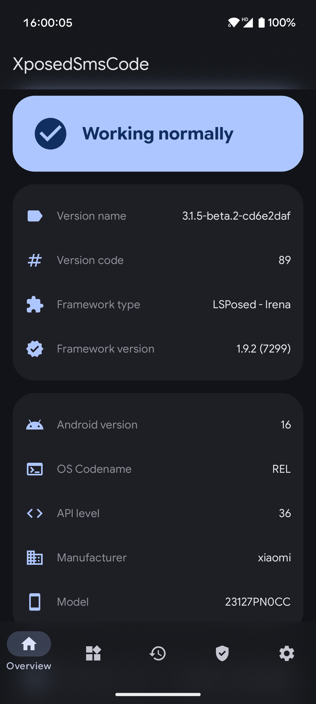
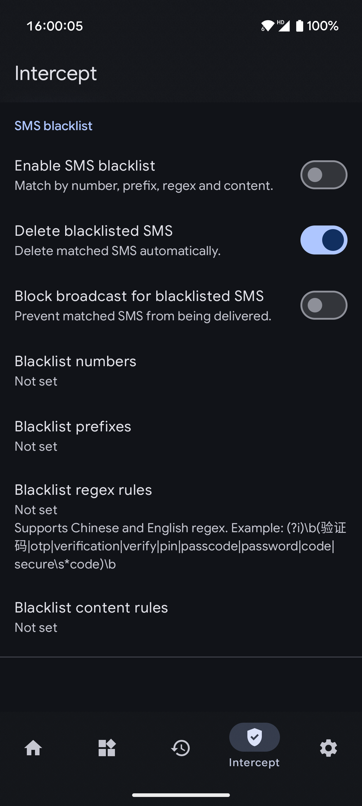
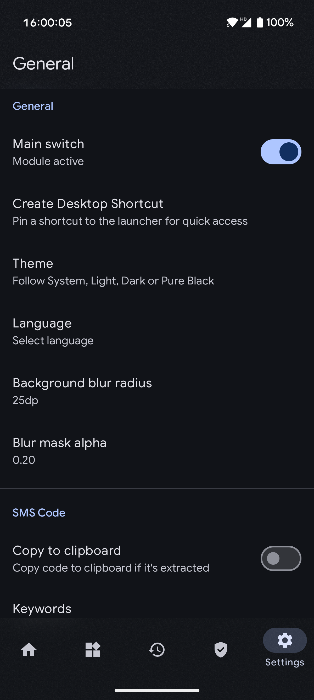

# XposedSmsCode

[中文](README.md) | [AGPLv3](LICENSE)

XposedSmsCode is an Android Xposed module that extracts verification codes from SMS messages and can copy, notify, or automatically enter them in supported apps.

This version processes SMS locally, using bundled and locally imported rules. Remote licensing, telemetry transport, in-app updates, and remote rule downloads have been removed. Optional WebDAV backups are initiated manually.

## Features

- Extract verification codes and optionally copy them to the clipboard or show a toast or notification.
- Automatically enter codes in supported apps, with configurable input delay and confirmation.
- Experimentally block verification SMS and configure keywords and regular expressions.
- Manage bundled and custom rules and keep a history of verification codes.
- Export and restore settings, rules, and records; manually upload, list, and restore backups over HTTPS WebDAV.
- Choose Material or Miuix interface styles and appearance settings.

## Requirements And Usage

Android 9.0 (API 28) or later, root, and an Xposed/LSPosed environment compatible with LibXposed API 102 are required. Compatibility may vary across ROMs.

1. Install the module, enable it in the framework, and reboot the device.
2. Enable the desired clipboard, notification, or auto-input options in the module settings.
3. For auto-input, enable the module's accessibility service in Android settings.

## Backup And Privacy

SMS recognition runs locally. WebDAV uses the Internet permission only when you initiate an operation against your configured HTTPS server. Backups can contain SMS content and verification codes; the files are not additionally encrypted by the app.

See [WebDAV backup](docs/WEBDAV.md), the [privacy policy](docs/PRIVACY.md), and the [security review](docs/SECURITY_REVIEW.md).

## Build

The project defaults to local dependencies and offline Gradle builds. It requires JDK 27, the Android SDK, and Python 3.11 or later. After configuring the environment, build a debug APK on Windows:

```powershell
.\gradlew.bat :app:assembleGithubDebug
```

See the [offline build guide](docs/OFFLINE_BUILD.md) for dependency provenance, setup, and the full local checks. The build uses a local debug signature and normally cannot update an installation signed with the original key.

## Screenshots



## Acknowledgments

Thanks to the [original project](https://github.com/tianma8023/XposedSmsCode), Xposed, and the open-source components used by this project.

## License

This project is licensed under the [GNU Affero General Public License v3.0](LICENSE). Included independent components and third-party dependencies retain their own licenses; see their respective directories and the [dependency provenance](docs/OFFLINE_BUILD.md).
