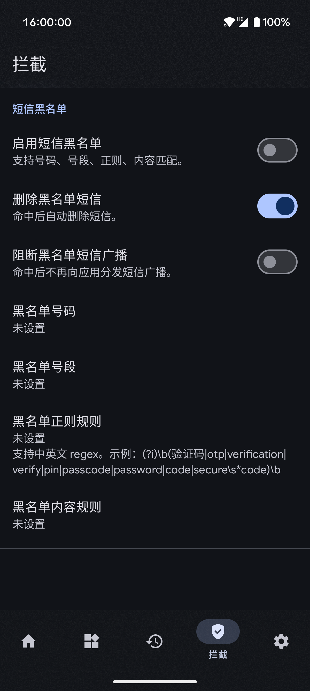
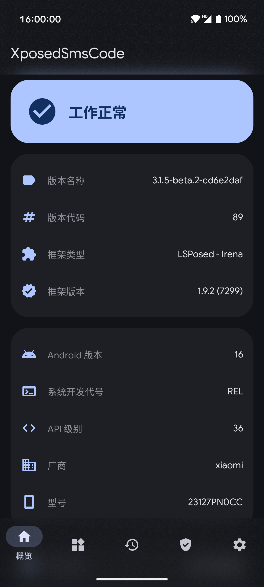
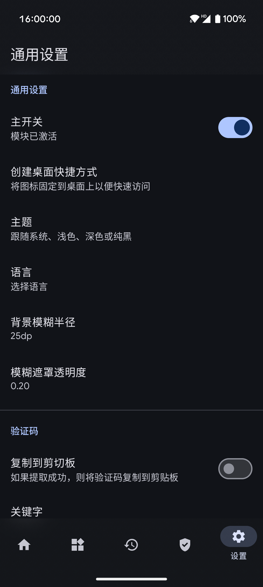

# XposedSmsCode

[English](README-EN.md) | [AGPLv3](LICENSE)

XposedSmsCode 是一个 Android Xposed 模块，用于从短信中识别验证码，并按设置复制、通知或在支持的应用中自动输入。

当前版本在设备本地解析短信，使用内置规则和本地导入的规则，不包含远程授权、遥测传输、应用内更新或远程规则下载。可选的 WebDAV 备份由用户手动操作。

## 功能

- 识别验证码并可选择复制到剪贴板、显示 Toast 或通知。
- 在支持的应用中自动输入验证码，可配置输入延迟和自动确认。
- 实验性拦截验证码短信，支持自定义关键字和正则表达式。
- 管理内置及自定义规则，保存验证码历史记录。
- 导出和恢复配置、规则及记录；通过 HTTPS WebDAV 手动上传、查看和恢复备份。
- 支持 Material 和 Miuix 界面风格及相关外观设置。

## 环境与使用

需要 Android 9.0（API 28）或更高版本、Root 和兼容 LibXposed API 102 的 Xposed/LSPosed 环境。不同 ROM 的兼容性可能有所差异。

1. 安装模块，在框架中启用并重启设备。
2. 在模块设置中按需启用复制、通知或自动输入等功能。
3. 使用自动输入时，在系统设置中开启本模块的无障碍服务。

## 备份与隐私

短信识别在本地进行。WebDAV 使用联网权限，仅在用户主动操作时连接配置的 HTTPS 服务器。备份可能包含短信正文和验证码，文件本身不额外加密，请妥善保管。

详细说明：[WebDAV 备份](docs/WEBDAV.md) · [隐私政策](docs/PRIVACY.md) · [安全检查记录](docs/SECURITY_REVIEW.md)

## 构建

项目默认使用本地依赖和离线 Gradle 构建，需要 JDK 27、Android SDK 和 Python 3.11 或更高版本。配置好环境后，在 Windows 上构建 Debug APK：

```powershell
.\gradlew.bat :app:assembleGithubDebug
```

依赖来源、环境配置和完整检查命令见[离线构建指南](docs/OFFLINE_BUILD.md)。构建产物使用本机调试签名，通常不能直接覆盖原版安装。

## 截图



## 致谢

感谢[原始项目](https://github.com/tianma8023/XposedSmsCode)、Xposed 及本项目使用的开源组件。

## 许可证

本项目采用 [GNU Affero General Public License v3.0](LICENSE)。仓库中包含的独立组件和第三方依赖保留各自的许可证，详见相应目录及[依赖来源](docs/OFFLINE_BUILD.md)。
